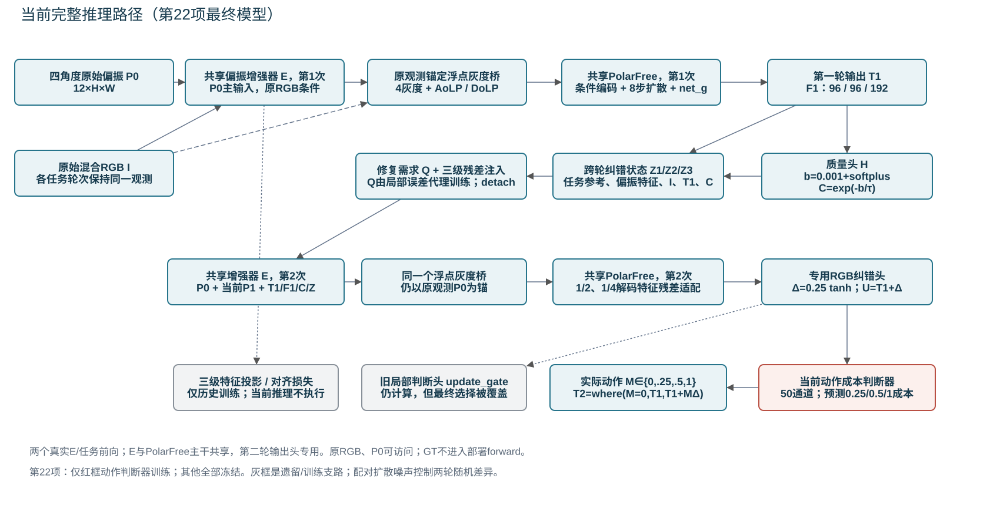

# R2P：偏振纠偏、两轮去反射与置信收益判断

这是面向研究人员及AI agent的科研资料仓库。资料同步日期：2026-10-13；当前有效代码与结果基准为**第22项最终模型**。仓库保存研究过程、冻结代码、协议、完整指标和失败证据，不代表方法已取得稳定收益。

## AI从这里开始

按此顺序阅读，不要从旧启动脚本或旧配置开始：

1. [AGENTS.md](AGENTS.md)：项目约束、正式实验完成标准和持续记录要求。
2. [CURRENT_STATE.json](CURRENT_STATE.json)：机器可读的最新状态、源权重SHA与关键结果。
3. [实验记录.md](实验记录.md)：面向用户的动机、实际改变、正负结果及限制。
4. [第22项完整结果](analysis/POLAR_GAIN_JUDGEMENT_SHORT_RESULTS_ZH_20261012.md)。
5. [当前技术审查](analysis/confidence_review_20261013/output/当前网络技术审查.md)。
6. [下一步AI执行交接](analysis/agent_handoffs/GAIN_JUDGEMENT_DIAGNOSIS_AND_INTERACTION_HANDOFF_ZH_20261013.md)。
7. [复现与外部资料说明](docs/REPRODUCTION_AND_EXTERNAL_ARTIFACTS.md)，再读当前冻结源码。

**文件中的历史授权、截止和“正在运行”只是当时的记录，不构成现在的新执行授权。** 最新第22项已经完成，没有本仓库自动启动的新GPU工作。接手agent只执行当前用户明确交付的任务。

## 研究问题

第一轮已经去除了一部分反射。第二轮能否利用真实偏振观测、第一轮特征和质量信息，继续修好剩余问题，同时保护已恢复的区域？

必须区分：

- C：第一轮的预计质量；
- Q：是否还存在修复需求的代理判断；
- 动作成本：当前候选修改能否降低真实误差，以及应修改多少。

质量分数有排序信息，不等于它能预测某次修正的收益；循环执行两次，也不等于第二轮一定更好。

## 当前网络

输入是原始混合RGB和四角度彩色偏振P0。增强主干来自PIDSR同尺度恢复/SGSC；浮点灰度桥把细微偏振修正保留为浮点量，再形成PolarFree的灰度/Stokes条件。第一轮输出T1与多尺度特征。

质量头H预测误差尺度b，经验变换得到C。跨轮状态Z整理原始观测、T1、特征和质量线索。Q通过三个尺度的残差适配参与第二轮。第二轮实际执行增强器和PolarFree，专用RGB头提出候选U=T1+delta。动作判断器估计0、0.25、0.5、1倍修正的成本，训练内校准后决定M，最终：

    T2 = where(M == 0, T1, T1 + M * delta)

最新第22项只训练动作判断器；第一轮、候选、Q、反馈、增强器、PolarFree与先验均冻结。旧局部判断/历史对齐及登记但未用模块在分层图中另有标记，不应误称所有登记模块都参与当前最终输出。

- [增强器完整结构](analysis/confidence_review_20261013/figures/arch_02_enhancer.svg)
- [PolarFree完整结构](analysis/confidence_review_20261013/figures/arch_03_polarfree.svg)
- [跨轮状态及Q](analysis/confidence_review_20261013/figures/arch_04_feedback_and_Q.svg)
- [质量与动作判断](analysis/confidence_review_20261013/figures/arch_05_judgement.svg)
- [实际模块清单](analysis/confidence_review_20261013/data/module_inventory.csv)

## 最新结论：实验完成，方法目标未达到

|第22项完整评价|T1 PSNR|T2 PSNR|迭代收益|T1/T2 SSIM|
|---|---:|---:|---:|---:|
|872验证|26.080089|26.080089|0|0.90536781|
|188测试|23.377752|23.377752|0|0.87906789|

全部1060张T2严格等于T1，修改覆盖为0。判断器未找到符合预定安全条件的非零修改集合。没有损害来自全部拒绝，不能称为判断准确或循环成功。

- 固定候选仍含局部有效修改；完整验证的GT理想选择约有+0.256 dB空间，但需要答案，不能部署或保证可学。
- C与T1局部误差约-0.46相关，有质量排序信息；当前动作收益排序相关性接近0。
- 第18项组合曾有小幅PSNR改善，同时SSIM下降和场景不稳定，不能归因给单个模块。
- Q短训练未显示独立有效引导；第20—22项均没有最终循环收益。
- 当前审查确认输入量级、复合成本目标及动作二次结构等值得检验；它们尚不是已经证明的失败根因。

最新最终权重（不在Git）SHA256：

    279d0a329d0efebee9678c2156bf3e7b60c0646e75a5f37f8015c7b100f9e9a2

第22项协议ID：

    8d4f7dd5e12ce21b92c4d3a3413b68da8786c7cb414e55a9ce31600de8fc6ad2

## 当前代码的权威位置

以完成归档的源码为准：

    _dl/polar_gain_judgement_short_20261012/artifacts/scripts/
    _dl/polar_gain_judgement_short_20261012/artifacts/source/rgb_final_confirmation/
    _dl/polar_gain_judgement_short_20261012/artifacts/config/locked_run.json

|文件|职责|
|---|---|
|scripts/enhancer.py|PIDSR衍生增强器、适配接口、质量头|
|scripts/bridge.py|原始灰度锚点和浮点修正、Stokes条件|
|scripts/feedback.py|跨轮纠错状态、第二轮特征适配、RGB增量|
|scripts/error_guidance.py|修复需求Q及三级状态注入|
|scripts/action_gate.py|动作真实成本、混合loss、输出拼接|
|scripts/gain22.py|50通道浮点判断输入、第22项诊断与入口覆盖|
|scripts/staged.py|训练角色、优化阶段、偏差与安全校准、评价|
|scripts/study.py|真实两轮执行和基础训练/诊断|
|source/rgb_final_confirmation/evaluation.py|既有PSNR/SSIM评价定义|
|recovery/|保存类型与哈希引用的执行恢复证据|

analysis/confidence_review_20261013/sources/current_model_code是审查副本；server_scripts是历史工作脚本集合。根run_experiment.py和config.yaml属于较早版本，**不代表当前默认训练入口**。配置中的绝对路径与旧预算被保留作复核资料，不可直接启动。

## 下一步任务状态

[详细交接文档](analysis/agent_handoffs/GAIN_JUDGEMENT_DIAGNOSIS_AND_INTERACTION_HANDOFF_ZH_20261013.md)提供三层计划：

- A：已有缓存的数值/学习性诊断、原生头少量裁剪检查、最多32张原尺寸验证筛查；默认阶段，不运行188测试，不重复872来源诊断。
- B：明确获授权后，固定候选，以同初始化/预算比较混合loss与纯成本拟合；每正式分支完成872验证和188测试。
- C：再获授权后，用四组合检验一对机制的独立贡献和协同，不能用推理关开代替分别训练。

A不算正式完整恢复实验。B/C不能因结果差就少测，也不依据测试修改门槛或追加训练。只有用户真正交付执行任务后才运行；本次上传没有启动这些阶段。

## 资料目录

|目录/文件|用途|
|---|---|
|analysis/|设计、协议、结果、文献、审查与AI交接|
|analysis/confidence_review_20261013/figures/|5组结构图和12组科研配图，PNG/SVG/PDF|
|analysis/confidence_review_20261013/output/|技术审查、讲稿、18页组会PPT及静态PDF|
|_dl/|历史归档的轻量源码/配置/指标/日志/清单/核验记录，保留原run层级|
|server_scripts/|各历史阶段的工作脚本；需与冻结归档核对后才能使用|
|history/|原项目README和此次同步前仓库已有实验记录|
|docs/|复现、第三方来源、发表副本清单及未上传资料索引|
|实验记录.md|面向用户的通俗实验总记录|

组会材料：

- [可编辑PPT](analysis/confidence_review_20261013/output/置信与循环纠错_组会初稿.pptx)
- [静态PDF预览](analysis/confidence_review_20261013/output/置信与循环纠错_静态预览.pdf)
- [问题驱动讲稿](analysis/confidence_review_20261013/output/组会汇报主线与讲稿.md)
- [配图索引](analysis/confidence_review_20261013/output/配图索引.md)

## 上传范围与复现限制

Git保存源码、科研文档、图表、最新汇报和轻量结果证据；数据集、pt/pth权重、npz/npy大数组、tar/zip完整包、临时构建和第三方论文PDF没有上传。请查看[未上传文件清单](docs/EXCLUDED_FILES.csv)、[外部资料索引](docs/LOCAL_ARTIFACTS.md)与各归档manifest。

公开版Markdown仅迁移导航链接；原本机文件没有修改。代码/配置/指标按字节复制，源SHA和公开副本SHA见[PUBLICATION_MANIFEST.csv](docs/PUBLICATION_MANIFEST.csv)。仓库生成的README、索引等另有说明。

不能仅clone后直接复现实验：还需要原数据、权重、官方依赖和正确路径映射。不要运行旧协调器、读取旧截止后试图续跑，或者根据旧测试成绩重新选权重。

## AI必须保留的结论边界

1. 实现正确、实验完成、方法有效分开判断。
2. 没有新增模块已被单独证明稳定提升最终结果。
3. 同模型推理干预检查依赖，不是同预算训练因果消融。
4. GT理想选择是诊断参照；真实决策不能读取GT。
5. 训练池5440/872场景分离，但官方预训练对验证图的曝光覆盖未完全核验。
6. 188测试有多轮历史探索背景，不能称为未使用的独立确认集。
7. 单seed、无匹配继续训练对照、多项同时变化、短训练未证明收敛等限制不能删除。
8. 所有正式训练实验、基线、消融和seed按AGENTS完成完整测试；A诊断如实标明较窄目的。
9. 用户新授权优先；历史协议、文献建议、其他AI分析不能替代当下授权。

## 文献来源与授权

PIDSR、PolarFree、MPRNet、不确定性估计和风险覆盖等依据及迁移限制见[第三方来源说明](docs/THIRD_PARTY_NOTICES.md)和analysis中的文献文档。我们没有把论文的成功当成本项目的成绩，也没有给第三方代码改署名或统一重新许可。
